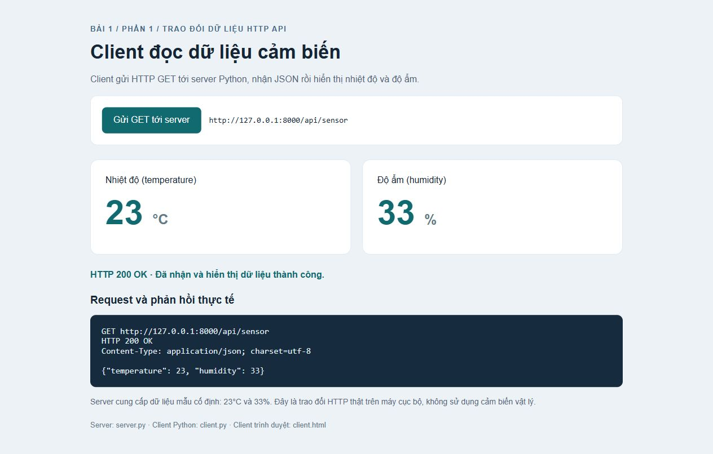
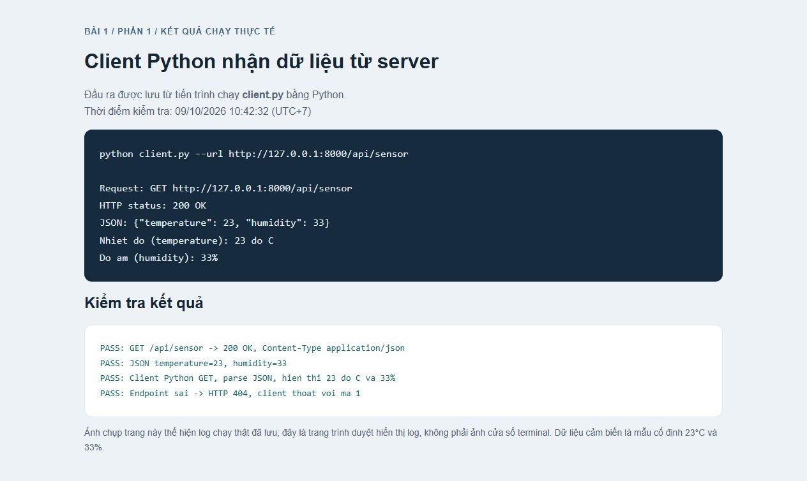

# Báo cáo Bài 1 - Phần 1: Trao đổi dữ liệu sử dụng HTTP API

Nhóm: ...
Lớp: ...
Thành viên: ...

## 1. Mục tiêu

Tạo server có dữ liệu nhiệt độ 23°C, độ ẩm 33%. Client gửi HTTP GET tới server, nhận JSON, phân tích và hiển thị kết quả.

## 2. Thiết kế

Python với thư viện chuẩn, không cần thư viện bên ngoài. API: `GET http://127.0.0.1:8000/api/sensor`. Server trả 200 OK và Content-Type application/json; charset=utf-8.

```json
{"temperature": 23, "humidity": 33}
```

Dữ liệu là mẫu cố định theo ví dụ trong đề; trao đổi HTTP thật trên máy cục bộ, không sử dụng cảm biến vật lý.

## 3. Chạy chương trình

Chạy `python server.py` tại terminal thứ nhất. Chạy `python client.py` tại terminal thứ hai. Để dùng client web, mở http://127.0.0.1:8000/ rồi bấm Gửi GET tới server. Nhấn Ctrl+C để dừng server.

## 4. Mã nguồn chính server

Đây là nhánh API cảm biến; server đầy đủ còn phục vụ giao diện HTML và nhận tùy chọn host/cổng.

```python
import argparse
import json
from http.server import BaseHTTPRequestHandler, ThreadingHTTPServer
from pathlib import Path
from urllib.parse import urlsplit

ROOT = Path(__file__).resolve().parent
SENSOR_DATA = {"temperature": 23, "humidity": 33}


class SensorHandler(BaseHTTPRequestHandler):
    def do_GET(self):
        path = urlsplit(self.path).path
        if path == "/api/sensor":
            # Chuyen du lieu Python thanh JSON va gui ve client.
            body = json.dumps(SENSOR_DATA).encode("utf-8")
            content_type = "application/json; charset=utf-8"
        else:
            self.send_error(404, "Endpoint not found")
            return

        self.send_response(200)
        self.send_header("Content-Type", content_type)
        self.send_header("Content-Length", str(len(body)))
        self.send_header("Cache-Control", "no-store")
        self.end_headers()
        self.wfile.write(body)

```

SENSOR_DATA lưu thông tin cảm biến. do_GET xử lý GET, json.dumps chuyển dữ liệu sang JSON, encode tạo byte. Server gửi mã 200, header Content-Type/Content-Length, rồi gửi body qua wfile.write. Đường dẫn không tồn tại trả 404. ThreadingHTTPServer và serve_forever giữ server hoạt động.

## 5. Mã nguồn client

```python
"""Client Python: gui HTTP GET, parse JSON va hien thi du lieu."""

import argparse
import json
import math
from urllib.error import HTTPError, URLError
from urllib.request import Request, urlopen


def read_sensor(url):
    request = Request(url, method="GET", headers={"Accept": "application/json"})
    with urlopen(request, timeout=10) as response:
        status = response.status
        data = json.loads(response.read().decode("utf-8"))
    if not isinstance(data, dict):
        raise ValueError("Du lieu JSON phai la mot object.")
    for field in ("temperature", "humidity"):
        value = data.get(field)
        if isinstance(value, bool) or not isinstance(value, (int, float)):
            raise ValueError(f"Truong {field} phai la so.")
        if not math.isfinite(value):
            raise ValueError(f"Truong {field} phai la so huu han.")
    if not 0 <= data["humidity"] <= 100:
        raise ValueError("Do am phai nam trong khoang 0 den 100%.")
    return status, data


def main():
    parser = argparse.ArgumentParser(description="Client HTTP GET - Bai 1")
    parser.add_argument("--url", default="http://127.0.0.1:8000/api/sensor")
    args = parser.parse_args()
    try:
        print(f"Request: GET {args.url}")
        status, data = read_sensor(args.url)
        print(f"HTTP status: {status} OK")
        print("JSON:", json.dumps(data, ensure_ascii=False))
        print(f"Nhiet do (temperature): {data['temperature']:g} do C")
        print(f"Do am (humidity): {data['humidity']:g}%")
    except HTTPError as exc:
        parser.exit(1, f"Loi HTTP: {exc.code}\n")
    except (URLError, TimeoutError, OSError) as exc:
        parser.exit(1, f"Loi ket noi: {exc}\n")
    except (ValueError, UnicodeError) as exc:
        parser.exit(1, f"Loi du lieu: {exc}\n")


if __name__ == "__main__":
    main()

```

Request chỉ định GET; urlopen gửi request với timeout 10 giây; json.loads phân tích phản hồi. Client kiểm tra giá trị rồi in nhiệt độ, độ ẩm. Các nhánh except xử lý HTTP lỗi, kết nối lỗi hoặc dữ liệu sai.

## 6. Ảnh kết quả



Hình 1. Client web gửi GET thật, nhận 200 OK, nhiệt độ 23°C và độ ẩm 33%.



Hình 2. Trang hiển thị đầu ra được lưu từ tiến trình chạy client.py thực tế. Đây là ảnh trình duyệt hiển thị log, không phải ảnh terminal.

## 7. Kết luận

Hoàn thành ba yêu cầu của Phần 1. Kiểm tra thêm HTTP 404 và client thoát với mã lỗi 1 khi đường dẫn API sai.

Nguồn yêu cầu: Bài 1. Trao đổi dữ liệu sử dụng HTTP API (VI).pdf, trang 1, Phần 1.
